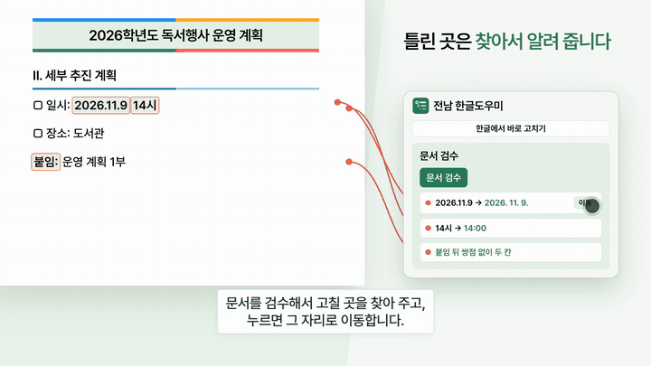
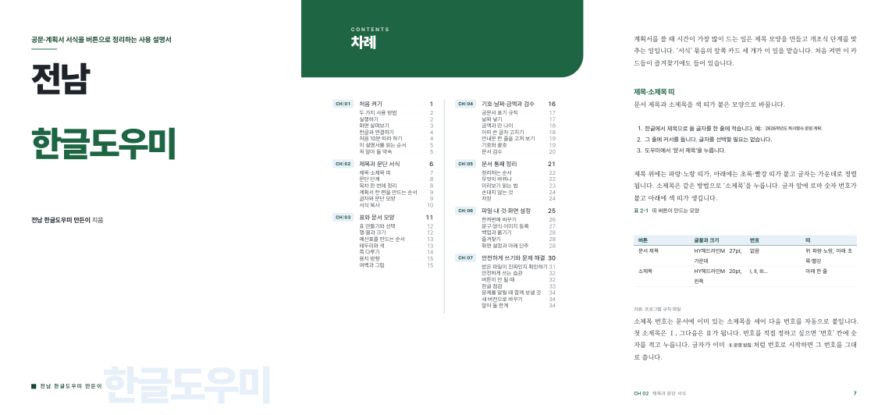

<p align="center">
  
</p>

<h1 align="center">전남 한글도우미</h1>

<p align="center">
  한글(한컴오피스)로 공문·계획서를 쓸 때 손이 많이 가는 서식 정리를 버튼으로 대신해 주는 Windows 프로그램
</p>

<p align="center">
  <a href="https://github.com/Dongnyeok-code/jeonnam-hangul-helper-release/releases/latest"><b>⬇ 최신 버전 내려받기</b></a>
  &nbsp;·&nbsp;
  <a href="docs/전남_한글도우미_사용설명서.pdf"><b>📘 사용 설명서 (PDF)</b></a>
  &nbsp;·&nbsp;
  <a href="docs/demo.mp4"><b>▶ 시연 영상 (51초)</b></a>
</p>

> 개인이 만든 도구입니다. 전남광주통합특별시교육청을 포함한 어떤 기관의 공식 프로그램도 아닙니다.

## 시연 영상

[](docs/demo.mp4)

영상 속 문서는 가상 예시입니다.

## 할 수 있는 일

| 탭 | 언제 쓰나 | 바뀌는 곳 |
|---|---|---|
| **한글에서 바로 고치기** | 한글에서 문서를 쓰는 중에 한 줄씩, 한 부분씩 고칠 때 | 지금 열려 있는 한글 문서 |
| **문서 통째 정리** | 다 쓴 HWPX·HWP 파일을 한 번에 정리할 때 | 새로 만들어지는 `원본이름_정리본.hwpx` |

- **제목·소제목 띠**: 줄에 커서를 두고 누르면 색 띠가 붙은 제목, 로마 숫자 번호가 붙은 소제목이 됩니다.
- **개조식 단계**: 여러 줄을 선택하고 누르면 □ ○ - · 단계와 들여쓰기·글꼴이 한 번에 맞춰집니다.
- **공문서 표기**: `2026. 11. 9.(월)`, `14:00`, `금113,560원(금일십일만삼천오백육십원)` 형식으로 넣거나 고칩니다.
- **문서 검수**: 날짜·시간·금액 표기가 규칙과 다른 곳을 찾아 보여 주고, 누르면 그 자리로 이동합니다.
- **표·쪽·용지**: 표 테두리·셀 계산, 쪽 복사, 문서 중간부터 가로 용지, 공문 표준 여백.
- **반복 작업 줄이기**: 자주 쓰는 문구·내 양식·로고 이미지 등록, 여러 파일 HWPX·PDF 변환, 문서 취합.

## 사용 설명서

[](docs/전남_한글도우미_사용설명서.pdf)

39쪽. 처음 켜기부터 문제 해결까지 순서대로 담았습니다. [PDF 열기](docs/전남_한글도우미_사용설명서.pdf)

## 내려받고 실행하기

1. [최신 버전 페이지](https://github.com/Dongnyeok-code/jeonnam-hangul-helper-release/releases/latest)에서 `JeonnamHangulHelper.exe`와 `JeonnamHangulHelper.exe.sha256`을 내려받습니다.
2. exe를 전용 폴더 하나에 넣습니다. 설치 과정은 없습니다.
3. 아래 방법으로 파일이 진짜인지 확인한 뒤 두 번 눌러 실행합니다.

필요 환경: Windows 10·11, 한글 2022에서 확인했습니다(다른 버전은 일부 버튼이 다르게 움직일 수 있습니다).

### 파일이 진짜인지 확인하기

exe가 있는 폴더에서 PowerShell을 열고 아래 명령을 실행합니다. 나온 값이 `.sha256` 파일 안의 값, 그리고 최신 버전 페이지에 적힌 값과 같아야 합니다.

```powershell
Get-FileHash .\JeonnamHangulHelper.exe -Algorithm SHA256
```

다르면 실행하지 말고 지우세요.

### "알 수 없는 게시자" 경고

유료 코드 서명 인증서가 없어서 Windows가 처음 실행할 때 경고를 띄울 수 있습니다. 위험하다는 뜻이 아니라 서명이 없다는 뜻입니다. **이 페이지에서 받았고 지문이 맞는 파일만** '추가 정보 → 실행'으로 여세요.

## 안전하게 쓰기

- **인터넷에 연결하지 않습니다.** 문서 내용이 밖으로 나가지 않습니다.
- **원본을 덮어쓰지 않습니다.** 정리본·변환 파일·취합본은 모두 새 파일입니다.
- **알아서 저장하지 않습니다.** 열려 있는 한글 문서는 '저장' 단추를 누를 때만 저장됩니다.
- **개인정보를 모으지 않습니다.** 사용 기록이나 문서 내용을 어디에도 보내지 않습니다. 문제 보고용 기록은 이 PC 안에만 남고, 문서 내용·문서 이름·폴더 경로는 적지 않습니다.

학교·기관 컴퓨터에 설치할 때는 소속 기관의 정보보안 규정을 먼저 확인하세요.

## 공식 배포처

**이 저장소 한 곳뿐입니다.** 다른 곳에서 받은 파일, 메신저로 전달받은 파일은 지문을 꼭 확인하세요. 다른 사람에게 알려 줄 때는 파일 대신 이 페이지 주소를 알려 주세요.

## 문제가 있을 때

프로그램의 '도구' 묶음에서 **문제 보고 만들기**를 누르세요. 최근 누른 버튼과 실패 이유를 모은 보고 글이 자동으로 복사되고, 보고 파일(`한글도우미_문제보고_날짜-시간.txt`)이 선택된 폴더 창이 열립니다. 글을 붙여 넣거나 파일을 끌어다 놓아 보내면 됩니다. 보고에는 문서 내용·문서 이름·폴더 경로가 들어가지 않고, 프로그램이 스스로 어디로 보내지도 않습니다.

더 자세히 알아야 할 때는 먼저 **한글 점검**(이 컴퓨터의 한글에서 버튼들이 되는지 새 빈 문서에서 시험)을 누른 뒤 보고를 만드세요. 이 저장소의 [Issues](https://github.com/Dongnyeok-code/jeonnam-hangul-helper-release/issues)에 올려도 됩니다. 문서 내용이나 학생 이름이 보이는 화면은 올리지 마세요.

## 사용 조건

개인과 학교·기관 업무에 무료로 쓸 수 있습니다. 고쳐서 다시 배포하거나 팔 수 없습니다. 자세한 내용은 [TERMS.md](TERMS.md), 함께 들어 있는 부품의 라이선스는 [THIRD_PARTY.md](THIRD_PARTY.md)를 보세요.
